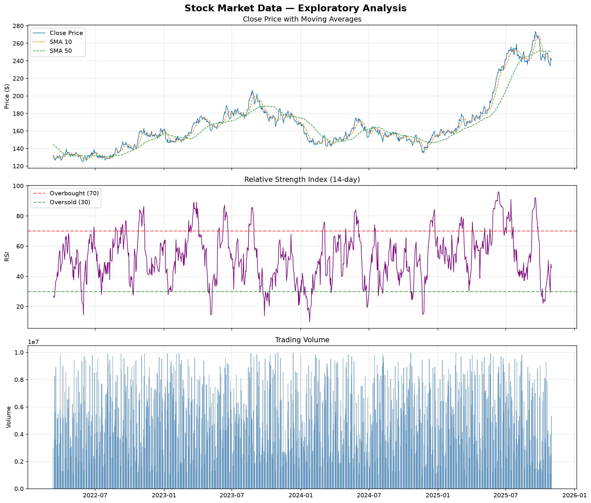
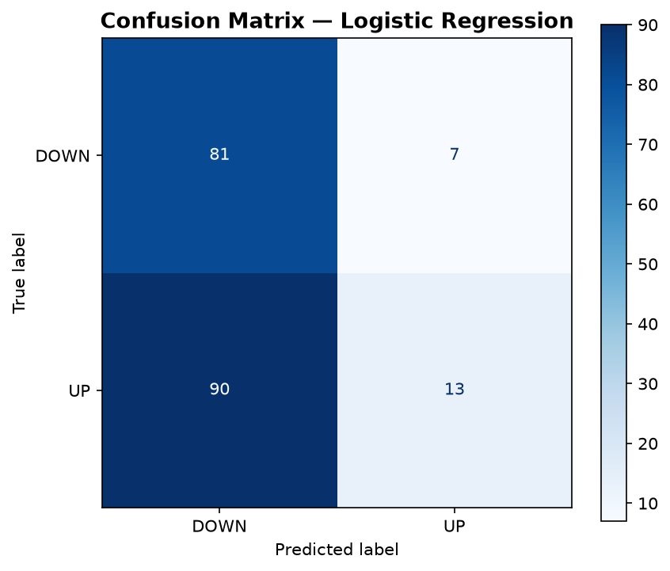
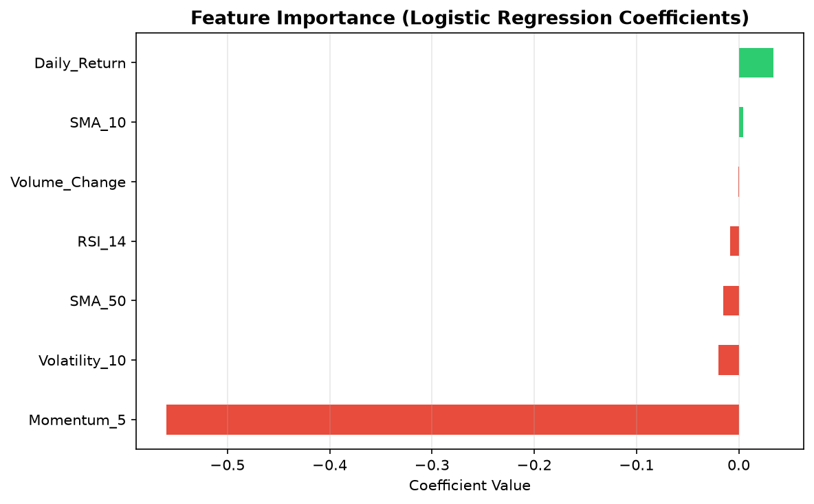
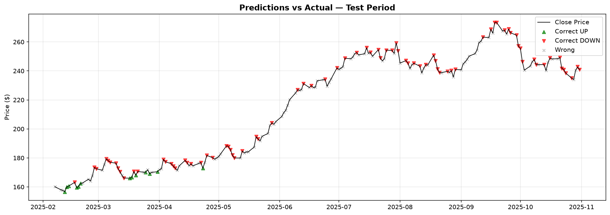

# Stock market Analysis & Direction Prediction

A Python-based stock market analysis and machine learning project that analyzes historical stock price trends, generates technical indicators, and predicts next-day market movement.

## Project Files
•⁠  ⁠⁠ stock_analysis.py ⁠ — Data preprocessing, technical indicator calculation, model training, and visualization script.
•⁠  ⁠⁠ requirements.txt ⁠ — Python dependencies required to run the project.
•⁠  ⁠⁠ 01_exploratory_analysis.png ⁠ — Historical price trends and exploratory data charts.
•⁠  ⁠⁠ 02_confusion_matrix.png ⁠ — Classification model evaluation matrix.
•⁠  ⁠⁠ 03_feature_importance.png ⁠ — Key technical indicators driving model predictions.
•⁠  ⁠⁠ 04_predictions_vs_actual.png ⁠ — Model predictions compared against actual market movement.

## Visual Results

### 1. Exploratory Analysis


### 2. Confusion Matrix


### 3. Feature Importance


### 4. Predictions vs Actual


## How to Run
```bash
pip install -r requirements.txt
python stock_analysis.py```
